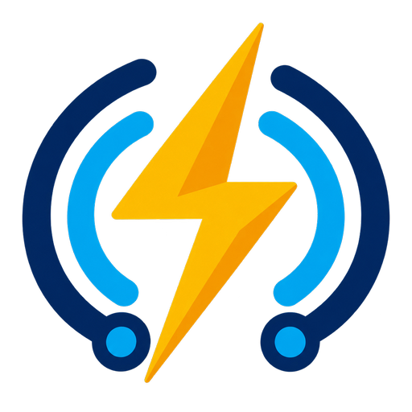

<p align="center">
  
</p>

# ESP32 Lightning Detector with MQTT

This project implements a lightning detection system using an ESP32 microcontroller and a WCMCU-3935 lightning detector module. The system detects lightning events and reports them via MQTT to a specified broker.

## System Architecture

### Hardware Components
- ESP32 Development Board
- WCMCU-3935 Lightning Detector Module
- 2x 4.7kΩ pull-up resistors (if not built into your board)
- Connecting wires

### Software Components
- ESP-IDF Framework
- PubSubClient for MQTT communication
- I2C driver for sensor communication

### Communication Flow
1. The WCMCU-3935 sensor communicates with the ESP32 via I2C
2. ESP32 polls the sensor every 100ms for lightning events
3. When lightning is detected, the event data is formatted as JSON
4. The JSON message is published to the configured MQTT broker
5. Clients subscribed to the MQTT topic receive the lightning event data

## Hardware Setup

### Wiring Diagram
```
WCMCU-3935    ESP32
VCC       ->  3.3V
GND       ->  GND
SCL       ->  GPIO22 (SCL)
SDA       ->  GPIO21 (SDA)
IRQ       ->  Not connected (optional for future use)
```

### Important Notes
- The WCMCU-3935 operates on 3.3V. DO NOT connect to 5V.
- Pull-up resistors (4.7kΩ) are required on both SDA and SCL lines if not present on your board
- Keep the wires between the ESP32 and the sensor as short as possible
- Mount the sensor away from other electronic components to minimize interference

## Software Setup

### Prerequisites
1. Visual Studio Code
2. PlatformIO IDE Extension
3. Git (optional, for version control)

### Installation
1. Clone or download this repository
2. Open the project folder in Visual Studio Code
3. Install the required dependencies via PlatformIO

### Configuration

#### MQTT Settings
Modify the following definitions in `src/main.cpp`:
```cpp
#define MQTT_BROKER_URI "mqtt://your_broker_ip"
#define MQTT_USERNAME "your_username"
#define MQTT_PASSWORD "your_password"
#define MQTT_TOPIC "lightning/detection"
```

#### I2C Pin Configuration
If needed, modify the I2C pins in `src/main.cpp`:
```cpp
#define I2C_MASTER_SCL_IO 22    // SCL pin
#define I2C_MASTER_SDA_IO 21    // SDA pin
```

## Building and Flashing

### Using PlatformIO IDE
1. Connect your ESP32 to your computer via USB
2. In VS Code with PlatformIO:
   - Click the PlatformIO icon in the sidebar
   - Click "Build" to compile the project
   - Click "Upload" to flash the ESP32
   - Click "Monitor" to view serial output

### Using Command Line

#### Prerequisites
1. Install Python 3.x if not already installed:
   ```bash
   # Check Python version
   python3 --version
   ```

2. Install PlatformIO Core:
   ```bash
   # Install PlatformIO
   python3 -m pip install -U platformio

   # Verify installation
   pio --version
   ```

#### Building the Project
```bash
# Initialize project (first time only)
pio project init --board esp32dev

# Install dependencies
pio pkg install

# Build the project
pio run

# Build specific environment
pio run -e release  # For release build
pio run -e debug    # For debug build

# Clean build files
pio run --target clean
```

#### Uploading and Monitoring
```bash
# Upload to ESP32
pio run --target upload

# Upload specific environment
pio run -e release --target upload

# Monitor serial output
pio device monitor

# Upload and monitor in one command
pio run --target upload --target monitor
```

#### Troubleshooting Build Issues

1. If you get "command not found: pio":
   ```bash
   # Add PlatformIO to your PATH
   export PATH=$PATH:$HOME/.platformio/penv/bin
   ```

2. For permission issues on MacOS/Linux:
   ```bash
   # Fix USB device permissions
   sudo usermod -a -G dialout $USER
   # Log out and back in for changes to take effect
   ```

3. For detailed build output:
   ```bash
   # Show verbose build information
   pio run -v
   ```

4. Common build flags for debugging:
   ```bash
   # Build with verbose compile output
   pio run -v
   
   # Build with specific environment and verbose output
   pio run -e debug -v
   ```

## Testing

### Functional Testing
1. Monitor the serial output for system status:
   - Successful I2C initialization
   - MQTT connection status
   - Lightning detection events

2. MQTT Testing:
   - Use an MQTT client (e.g., MQTT Explorer, Mosquitto)
   - Subscribe to the topic "lightning/detection"
   - Example message format:
     ```json
     {"event":"lightning","energy":123}
     ```

### Hardware Testing
1. Safe Distance Testing:
   - Use an electric lighter at 30+ cm from the sensor
   - Observe the serial output and MQTT messages

2. Environmental Testing:
   - Place the sensor near a window during a thunderstorm
   - Verify detection range and accuracy

### Troubleshooting

#### No I2C Communication
- Check wiring connections
- Verify pull-up resistors
- Confirm 3.3V power supply
- Check I2C address (default: 0x03)

#### MQTT Connection Issues
- Verify network connectivity
- Check broker address and credentials
- Ensure broker is running and accessible
- Check firewall settings

#### No Lightning Detection
- Verify sensor power supply
- Check I2C communication
- Test with controlled static discharge
- Verify sensor positioning

## Safety Considerations
- This device is for educational and hobby use only
- Do not rely on this device for critical safety decisions
- Keep the device away from high voltage sources
- Follow proper ESD safety when handling components

## Future Enhancements
- Implement IRQ pin support for interrupt-driven detection
- Add WiFi configuration portal
- Implement OTA updates
- Add distance estimation
- Implement noise filtering
- Add web interface for configuration

## License
This project is released under the MIT License. See the LICENSE file for details.

